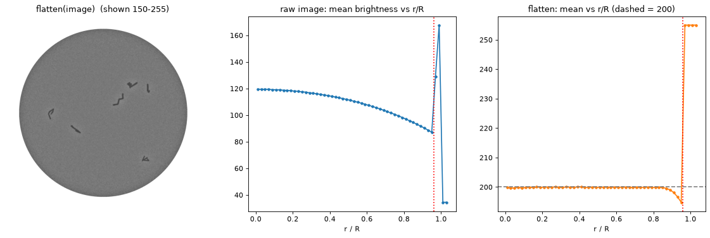

# ベースライン U-Net の誤差分析（2026-10-12）

## 結論
- 失点の中心は**余計な予測（FP）**で、FN の約2倍ある。後処理で手の届く部分が大きい。
- 見逃しの87%は「その1人のアノテーターだけが描いた」フィラメントで、大半はアノテーター間の不一致。確かな取りこぼしは34本だけ。
- 後処理の改善の目安：確率でのフィルタ +0.02、破片の接続 +0.04、最小面積で消えた本物を拾う +0.01（どれも楽観的な近似）。
- 相談したいこと：前処理／後処理の分担、ヒステリシスと GBM フィルタの部品を main に入れる PR（最後の節）。

## 対象
| 項目 | 内容 |
|---|---|
| モデル | ベースラインの U-Net（`solution/cnn_baseline/main.py`）。Kaggle の notebook `iceqbie/filament-cnn-baseline` v2、2026-10-02 実行、T4 で36分 |
| 後処理 | しきい値 0.5 + 連結成分 + 最小面積 400 + 円盤外マスク（ヒステリシスと GBM フィルタは**なし**） |
| 検証データ | seed 0、物理画像単位で15%（106枚）。正解 1,387本（アノテーター × フィラメント）、予測 1,900行（アノテーター × 予測） |
| 結果 | **PQ 0.340**（SQ 0.665 / RQ 0.512）。LB 0.31 |
| 参考 | アノテーター同士の一致度は PQ 0.34（SQ 0.63 / RQ 0.54、複数人が描いた296枚） |

以下の数字とギャラリー画像は、`error_analysis/run.py` が notebook の最後に出力したもの（`errors_gt.csv`、`errors_pred.csv`、`error_report.json`、`gallery_*.png`）から計算した。

## 全体の数字
| | TP | FP | FN | 適合率 | 再現率 | SQ | RQ | PQ |
|---|---|---|---|---|---|---|---|---|
| ベースライン | 841 | 1,060 | 546 | 0.44 | 0.61 | 0.665 | 0.512 | 0.340 |

RQ は適合率と再現率の調和平均（F1）と一致する。SQ より RQ が低く、**弱いのは「見つけ方」、特に余計な予測（適合率 0.44）**。

誤りの内訳：

| 正解側（1,387） | 数 | 予測側（1,900） | 数 |
|---|---|---|---|
| matched（一致） | 841 | matched | 840 |
| missed（見逃し） | 186 | hallucination（偽の予測） | 520 |
| near_miss（惜しい、IoU ≤ 0.5） | 185 | near_miss | 185 |
| fragmented（割れ） | 143 | fragment（破片） | 340 |
| merged（まとまり） | 32 | merge | 15 |

what-if（その種類の誤りを完全に直したら）：

| シナリオ | PQ | 上昇幅 |
|---|---|---|
| 輪郭が完璧（SQ = 1） | 0.512 | +0.171 |
| FP なし | 0.502 | +0.162 |
| FN なし（SQ はそのまま） | 0.481 | +0.141 |
| FP 半分 | 0.406 | +0.065 |
| 偽の予測なし | 0.404 | +0.064 |
| 惜しい予測を IoU 0.5 超えに | 0.398 | +0.057 |

どれも上限で、現実には届かない。人間同士でも SQ は 0.63 なので、「輪郭が完璧」は意味のある目標ではない。

## 誤りの種類ごとの所見
各ギャラリー（Slack で共有）は、その種類の誤りのうち大きい8例。緑 = そのアノテーターの正解、赤 = 予測。`dark` は周囲より何割暗いか、`p` はその領域の平均確率。各節の最初の箇条書きは、そのギャラリーを見て読み取ったこと。「数字で見ると」以降は、誤差の表から計算した値。

### 見逃し（missed、186本）
> ギャラリー画像 `gallery_missed.png`（見逃しの大きい8例）は、コンペの実データを含むためリポジトリに入れず、Slack で共有している。

- どれも小さい（277〜1,463px）。
- 薄いもの（dark 0.00〜0.06）は、モデルがまったく反応していない（p ≈ 0）。
- 一方で、**p = 0.85〜0.88 なのに見逃されたもの**（面積 約330px）がある。モデルは見つけていたのに、最小面積 400 で捨てられた。
- 数字で見ると：
  - 186本のうち **162本（87%）は、その1人だけが描いた**フィラメント（他の誰も描いていない）。3人全員が描いたフィラメントの見逃しは 0本。
  - モデルが反応していた（平均確率 ≥ 0.5）のは66本。そのうち **44本は面積 400 未満**で、後処理で消えた。
  - 他の人も描いたのに、モデルが反応していない見逃し・惜しい予測は **34本**（missed 15、near_miss 19）。前処理・モデルで確実に狙えるのはここ。

| アノテーターの一致数 | 正解 | 一致 | 見逃し | 惜しい | 割れ |
|---|---|---|---|---|---|
| 0（その人だけ） | 855 | 441 | 162 | 133 | 98 |
| 1人 | 362 | 257 | 24 | 47 | 29 |
| 2人（全員） | 170 | 143 | 0 | 5 | 16 |

### 偽の予測（hallucination、520個）
> ギャラリー画像 `gallery_hallucination.png`（偽の予測の大きい8例）は、コンペの実データを含むためリポジトリに入れず、Slack で共有している。

- ギャラリーの上位は、大きく（3,500〜6,400px）、確信度が高い（p 0.95〜0.97）。見た目は**フィラメントらしい暗く細長い構造**で、このアノテーターが描かなかっただけに見えるものが多い。8例中4例は円盤の縁の近く。
- 数字で見ると：
  - 全体では**小さいものが多い**：658px 未満が238（46%）、658〜1,047px が143、1,047〜1,886px が85、それ以上が54。
  - **周縁寄り**（中心から 0.8R より外）が228（44%）。特に 0.85〜0.9R では、偽物123個に対して一致は39個だけ。
  - **74個は、同じ画像の別のアノテーターとは一致**している（人による判断の違い。どう後処理しても、ある人には FP になる）。
  - 偽物と一致した予測を、平均確率で分けると AUC 0.83（面積 0.74、細長さ 0.72）。2段目のフィルタが効く見込みがある。

### 割れ（fragmented、143本）
> ギャラリー画像 `gallery_fragmented.png`（割れの大きい8例）は、コンペの実データを含むためリポジトリに入れず、Slack で共有している。

- **巨大で薄いフィラメント**（1.1万〜3万px、dark 0.02〜0.06）で起きている。
- アノテーターは薄い部分まで含めて幅広く描くが、モデルは暗い部分だけを点々と予測している。
- 数字で見ると：
  - 面積が上位25%の正解の31%が割れている。
  - 破片の数の中央値は2、正解のうち予測に覆われている割合の中央値は 0.57。
  - **破片を全部つなげば IoU > 0.5 になりそうなのは約78本**（143本中）。残りは、覆えていない薄い部分が大きすぎる（つなぐだけでは直らず、薄い部分を拾う必要がある）。

### 惜しい予測（near_miss、185本）
> ギャラリー画像 `gallery_near_miss.png`（惜しい予測の大きい8例）は、コンペの実データを含むためリポジトリに入れず、Slack で共有している。

- 予測が、正解の**暗い芯の部分だけ**を覆っている。正解は barb（横のとげ）や薄い端まで描いている。
- 一致したものの「予測の面積 ÷ 正解の面積」の中央値は 1.03 なので、輪郭が全体的に細いわけではない。薄い部分を拾えていないものが惜しい予測になっている。

### まとまり（merge、予測15個 / 正解32本）
> ギャラリー画像 `gallery_merge.png`（まとまりの大きい8例）は、コンペの実データを含むためリポジトリに入れず、Slack で共有している。

- アノテーターが2本に分けて描いたものを、モデルが1本としてつないでいる。
- 見た目では、どちらが正しいか決めにくい。分け方そのものが人によって違う可能性がある。数も少ないので、優先度は低い。

### 傾向（暗さ別）
| 暗さの四分位 | 正解 | 一致 | 見逃し | 惜しい | 割れ |
|---|---|---|---|---|---|
| いちばん薄い25% | 347 | 97（28%） | 92 | 86 | 67 |
| 2番目 | 347 | 210 | 39 | 42 | 52 |
| 3番目 | 346 | 263 | 32 | 26 | 17 |
| いちばん暗い25% | 347 | 271（78%） | 23 | 31 | 7 |

薄いフィラメントでは、見逃しだけでなく、割れと惜しい予測も多い。

## 後処理の試算（表の上だけで）
「面積 < X、または平均確率 < Y の予測を捨てる」を、誤差の表の上で再現した PQ（X = 0 が今のまま）：

| 最小面積 \ 平均確率の下限 | 0.00 | 0.92 | 0.94 | 0.95 | 0.96 |
|---|---|---|---|---|---|
| 0 | 0.340 | 0.348 | **0.363** | 0.362 | 0.306 |
| 500 | 0.342 | 0.347 | 0.360 | 0.361 | 0.306 |
| 600 | 0.339 | 0.342 | 0.353 | 0.355 | 0.305 |
| 800 | 0.327 | 0.329 | 0.335 | 0.334 | 0.298 |

- 平均確率 0.94 で切るだけで +0.023。最小面積を上げるのは逆効果。
- 近似の限界：破片を捨てたときに残りが一致に変わる効果は無視。最小面積 400 ですでに捨てた予測は表にないので、最小面積を**下げる**方向は試算できない（確率マップが必要）。同じ検証データで選んでいるので楽観的。

## 改善余地の目安
| 担当 | 対策 | 直りそうな数 | PQ の増分 |
|---|---|---|---|
| 後処理 | 平均確率 0.94 未満を捨てる | — | +0.023 |
| 後処理 | 割れた破片をつなぐ | 78本 | +0.041 |
| 後処理 | 最小面積で捨てた本物を拾う | 44本 | +0.013（上限） |
| 前処理 | 他の人も描いた、反応していない見逃し・惜しい予測を拾う | 34本 | +0.012 |
| 前処理 | いちばん薄い25%の見逃し・惜しい予測を半分拾う | 89本 | +0.031（楽観的） |

すべて同じ検証106枚での近似で、足し算にはならない。検証1回の結果なので、±0.02 くらいはノイズの範囲。「どこを狙うか」の目安として見てほしい。

## 前処理について気づいたこと（合成画像で確認）

`tests/synthetic.py` の合成画像で `flatten`（周縁減光の補正）を確かめた。補正後の背景は 0.88R まで 200 で平らだが、**縁の手前（0.88〜0.96R）で約194まで、約3%暗く出る**。σ = 40px の背景の推定が、縁で急に暗くなる本当の背景に追いつかず、背景を明るく見積もるため。フィラメントは背景の 0.88〜0.9倍しかないので、この3%でも誤判定の原因になりうる。上の「0.85〜0.9R で偽物が多い」ことの原因の候補（実画像ではまだ未確認）。

## そちらの分析との比較
そちらの分析（ヒステリシス 0.5/0.2 + 最小面積 150 + GBM フィルタ、PQ 0.3767）では、見逃し377、惜しい184、割れ59。こちら（後処理なし）は見逃し186、惜しい185、割れ143、偽の予測520。

**後処理を足したことで、失点が「偽の予測・割れ」から「見逃し」に移っている**ように見える（ヒステリシスで割れが減り、フィルタで偽物が減ったぶん、本物も一部捨てている）。この見方で合っていそうか、意見がほしい。

## 相談したいこと
1. **前処理／後処理の分担。** 数字を見ると、後処理は再学習なしで試せて、改善の見込みも見えやすい。前処理は試すたびに再学習（GPU 約40分）が要るが、薄いフィラメントの割れ・惜しい予測に効く可能性がある。どちらから手をつけるか決めたい。
2. **ヒステリシス版の `instances` と `filtering.py`（GBM フィルタ）を、それだけ小さな PR で main に入れてもらえないか。** 後処理をやるなら、その上に積みたい。
3. **エポックごとの検証の記録。** 今は学習の損失しか記録していないので、過学習の確認や checkpoint の選択ができない。どちらの担当でも、最初にこれを入れたい。

## 注意
- ギャラリー画像はコンペの実データ（学習用画像と配布の注釈）を含むので、リポジトリには入れていない（リポジトリは締切後に公開する予定のため）。Slack で共有したものをチーム内だけで使うこと。手元で作り直すには `uv run filament run solution/cnn_baseline/main.py --figures`（`outputs/cnn-baseline/` に出力される）。
- 図 `figures/synthetic_flatten_profile.png` は合成画像（`tests/synthetic.py`）から作ったもので、実データを含まない。
- 分析に使ったスクリプトは手元にある。必要なら共有する。
